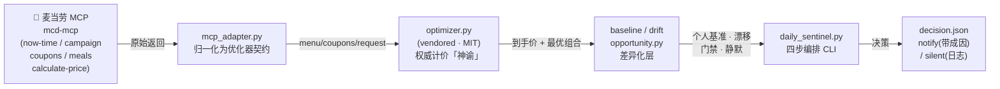
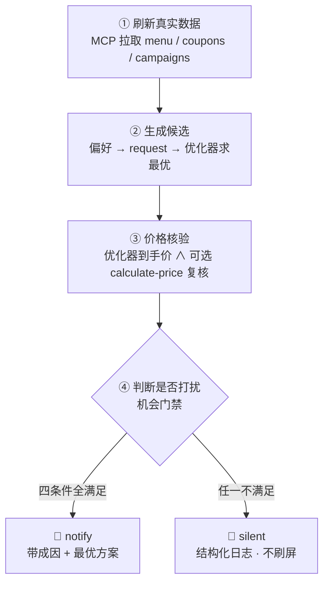
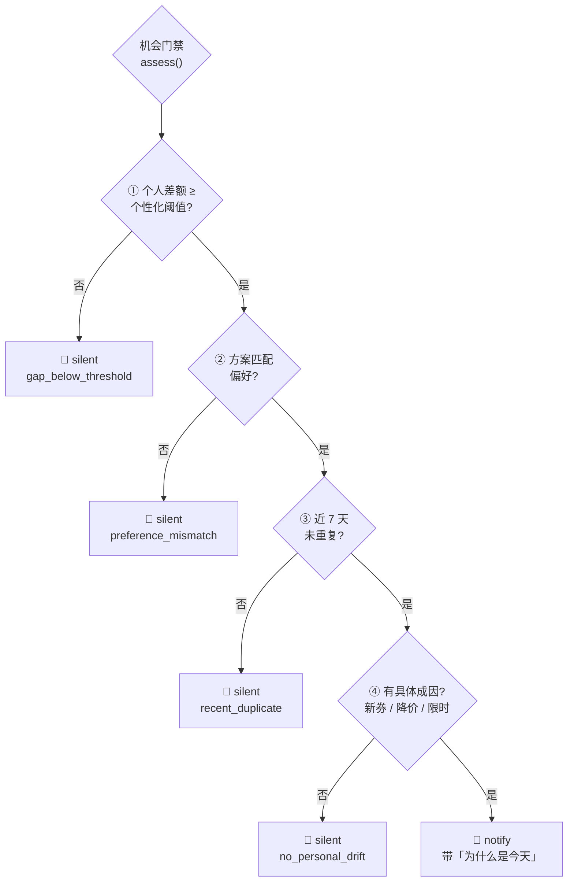

<p align="center">
  
  
  
  
  
</p>

# 🍟 麦麦好价哨 · MaiMai Good-Price Sentinel

> 基于麦当劳中国 MCP 的**主动省钱机会哨兵** Skill —— 你不用每天来问，它每天替你判断：今天有没有**对你**真正值得吃的便宜。

> 🏆 本仓库为「麦当劳程序员创意开发大赛」参赛作品。非麦当劳官方产品，仅供参考。

---

## ✨ 它回答什么问题？

| | 普通省钱助手 / 优惠聚合 | **麦麦好价哨（本 Skill）** |
|---|---|---|
| 🔔 触发 | 用户每次手动问「现在怎么点最便宜」 | **每天自动跑**，用户无需记得来问 |
| 📌 锚点 | 菜单全局最低价 | **你的个人基准**（你平时花多少、常吃啥） |
| 📤 输出 | 一份最低价套餐清单 | **值得行动才推送**，否则静默 |
| 🧩 差异化 | 优惠整合 + 个性化策略（已有竞品） | 个人基准 + 机会门禁 + 漂移检测 + **带成因的静默** |

> 💡 **核心论点**：别人回答「现在怎么点最便宜」；麦麦好价哨回答「今天是否出现了一个**对你而言**真正值得采取行动的省钱机会？」——**没有，就闭嘴。**

---

## 🧭 架构总览

麦麦好价哨是一个**通用的省钱机会哨兵 Skill**——以 WorkBuddy 原生 `SKILL.md` 作为标准实现形态，其核心逻辑（`scripts/` 下的跨平台 Python）可运行于**任何能接入麦当劳 MCP 并定时触发脚本的 Agent 平台**，而非仅限 WorkBuddy。它对接**麦当劳中国 MCP Server**，不只是一把「算一次最便宜」的计算器，而是一个**主动哨兵**：每天按四步循环刷新真实数据、按你的偏好生成候选、调用优化器做权威计价、再判断今天是否值得打扰你。**绝大多数日子它保持静默**——只在「对你出现了一个带成因的省钱机会」时才出声，且每条必带「为什么是今天」。



> 🪜 **双层结构 · 跨平台**：本仓库由「跨平台 Python 引擎」（`scripts/` + vendored 优化器，纯标准库、零平台依赖）+「WorkBuddy 原生 Skill 定义」（`SKILL.md`）组成。引擎**不依赖 WorkBuddy**，可在任意能定时运行脚本并接入麦当劳 MCP 的环境独立运行；`SKILL.md` 仅是 WorkBuddy 这一宿主的「加载入口」，其他遵循 Skill 规范的宿主亦可等价加载其指令与流程。

| 文件 | 职责 |
|------|------|
| `vendor/mcd-saver-strategist/` | 复用的确定性优化器（MIT，原样引入） |
| `scripts/mcp_adapter.py` | MCP 返回 → 优化器 JSON 的归一化与快照组装 |
| `scripts/baseline.py` | 个人基准（常点项 + 历史）+ 反馈闭环自适应阈值 |
| `scripts/drift.py` | 昨日/今日快照比对，识别对「该用户」有意义的变动 |
| `scripts/opportunity.py` | 个人差额评分 + 四条件门禁 + 必带成因 + 默认静默 |
| `scripts/daily_sentinel.py` | 四步循环编排 CLI（可复现、可测试） |
| `scripts/test_sentinel.py` | 差异化层自测（26 项） |

---

## 🔄 每日哨兵四步循环

每天固定时刻自动跑一遍，自行判断是否值得打扰你：



---

## 🚦 机会门禁（全满足才推送）

四条件**全部满足**才出声，否则静默——这是「主动哨兵」区别于「每日最低价推送外壳」的根本。



> ⚠️ 没有成因的便宜价 = 常态，不打扰。**静默不等于失效**：它说明「今天对你没有比平时更划算的新机会」，恰是用户想要的「省心」。

---

## 🎯 功能特性

| 能力 | 说明 | 对应 MCP 工具 |
|------|------|---------------|
| **个人基准** | 基于常点项 + 可选订单历史，建立「典型一餐」参照系 | `query-my-coupons` / `query-meals` |
| **每日哨兵循环** | 四步自动判断：刷新→生成→核验→是否打扰 | `now-time-info` / `campaign-calendar` / `query-meals` / `calculate-price` |
| **机会门禁** | 四条件（差额/偏好/去重/成因）全满足才推送 | —（本 Skill 逻辑） |
| **漂移检测** | 识别对你有意义的变动：新券 / 常点项降价 / 限时活动 | `campaign-calendar` / `query-my-coupons` |
| **反馈闭环** | 你忽略/采纳后自适应微调打扰阈值 | —（本 Skill 逻辑） |
| **智能领券** | 发现高价值券、查重、二次确认后领取 | `query-my-coupons` / `auto-bind-coupons` |
| **活动蹲守** | 限时活动力度解读，作为推送成因 | `campaign-calendar` |

---

## 🚀 快速开始

### 1️⃣ 获取麦当劳 MCP Token
前往 [open.mcd.cn/mcp](https://open.mcd.cn/mcp) 用手机号登录，在「控制台」激活并复制 MCP Token。

### 2️⃣ 接入 mcd-mcp（以 WorkBuddy 为例）

> 麦当劳 MCP 是标准 MCP Server，本配置为通用定义，**不限于 WorkBuddy**。任意兼容 MCP 的宿主（WorkBuddy、Claude Desktop、Cursor、Cline 等）把它加入 MCP 客户端配置即可。

**WorkBuddy 用户**：左侧边栏「专家·技能·连接器」→「连接器」→ 右上角「自定义连接器」→「配置 MCP」，填入：

```json
{
  "mcpServers": {
    "mcd-mcp": {
      "type": "streamablehttp",
      "url": "https://mcp.mcd.cn",
      "headers": {
        "Authorization": "Bearer ${MCD_MCP_TOKEN}"
      }
    }
  }
}
```

### 3️⃣ 安装 / 运行本 Skill（核心逻辑跨平台）

本仓库真正执行省钱判断的是 `scripts/` 下的纯 Python（`mcp_adapter.py` / `baseline.py` / `drift.py` / `opportunity.py` / `daily_sentinel.py`），**不依赖 WorkBuddy**，在任意装有 Python 3 且能连接麦当劳 MCP 的环境即可运行。

- **WorkBuddy 用户**：把 `SKILL.md` 复制到用户技能目录（下方命令），由 WorkBuddy 定时任务驱动：

```bash
# macOS / Linux
mkdir -p ~/.workbuddy/skills/maimai-haojiasao
cp SKILL.md ~/.workbuddy/skills/maimai-haojiasao/SKILL.md

# Windows (PowerShell)
Copy-Item SKILL.md "$env:USERPROFILE\.workbuddy\skills\maimai-haojiasao\SKILL.md" -Force
```

- **其他 MCP 宿主**：把 `mcd-mcp` 加入宿主的 MCP 配置（见 `mcp-config.example.json`），并按 `SCHEDULE.md`「通用运行方式」定时执行 `python scripts/daily_sentinel.py` 即可，无需 WorkBuddy。

### 4️⃣ 配置个人偏好 & 设个每日任务
- 编辑 `preferences.example.json`（复制为 `preferences.json`），填入你的常点项与阈值。
- 按 `SCHEDULE.md` 配置每日自动化，让哨兵每天自动运行。

### 5️⃣ 开始对话
```
用户：每天帮我看看麦当劳有没有值得吃的
用户：今天麦当劳有什么对我特别划算的吗
用户：把能领的券都帮我领了（需确认）
```

---

## 🧪 本地验证

```bash
# 上游优化器未被改动（期望 46 passed）
python vendor/mcd-saver-strategist/selftest.py

# 本 Skill 差异化层（期望 26 passed）
python scripts/test_sentinel.py

# 端到端演示（用 vendored 示例数据，预计产出 notify 并带成因）
python scripts/daily_sentinel.py --demo \
  --preferences preferences.example.json \
  --state state.example.json --out decision.example.json --today 2026-10-18
```

---

## 📂 项目结构

```
.
├── SKILL.md                  # 主体：角色 / 四步循环 / 门禁 / 护栏
├── README.md                 # 本文件
├── CONTEST_DECLARATION.md    # 参赛声明（官方原文，一字不改）
├── MCP_INTEGRATION.md        # MCP Server / Tool / 调用流程 / 真实联调记录
├── SCHEDULE.md               # 每日自动化规范（定时任务 Prompt 模板）
├── THIRD_PARTY.md            # 第三方依赖与 MIT 复用标注
├── LICENSE.txt               # 本仓库许可（MIT）+ 第三方说明
├── mcp-config.example.json   # 脱敏 MCP 配置示例
├── preferences.example.json  # 用户偏好示例
├── snapshot.example.json     # 归一化快照示例
├── state.example.json        # 状态文件示例
├── decision.example.json     # 决策输出示例（notify）
├── vendor/mcd-saver-strategist/   # 复用的确定性优化器（MIT，原样）
└── scripts/                  # 本 Skill 差异化层（见上表）
```

---

## ✅ 真实使用验证

本项目已通过 MCP（以 WorkBuddy 连接器 `mcd-mcp` 为例）对麦当劳 MCP 进行端到端调用（时间 / 活动日历 / 我的券均返回真实数据），证明与 `mcp.mcd.cn` 联通与鉴权有效，满足活动「真实使用麦当劳 MCP 能力」要求。详见 `MCP_INTEGRATION.md` 第 5 节联调记录。

---

## ⚠️ 免责声明

本 Skill 为麦当劳程序员节创意开发大赛参赛作品，由参赛者独立开发，**非麦当劳官方产品**。项目输出仅供参考，不构成专业建议；餐品信息、价格及供应状态**以麦当劳官方渠道的实时结果为准**。第三方优化器以 MIT 许可复用，版权归原作者所有。
